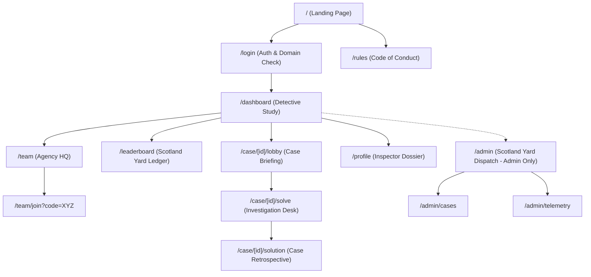

# ELECZZA 2.0 — Phase 0: Discovery & Design Brief

> **Project Code:** ELECZZA 2.0  
> **Target Audience:** Students of Academy of Technology (AOT)  
> **Theme:** Victorian Noir / Sherlock Holmes (221B Baker Street & Scotland Yard)  
> **Framework:** Next.js (App Router), Tailwind CSS, Framer Motion, TypeScript

---

## 1. Domain Access & Authentication Boundary

To ensure the contest is exclusive to verified students of the Academy of Technology, domain whitelisting is enforced at both client and server boundaries:

- **Allowed Domain:** `@aot.edu.in`
- **Environment Variable:** `NEXT_PUBLIC_ALLOWED_EMAIL_DOMAIN=@aot.edu.in`
- **Enforcement Rules:**
  - Client-side validation: RegEx matching `^[a-zA-Z0-9._%+-]+@aot\.edu\.in$` before form submission.
  - Server-side auth hook / Supabase or NextAuth domain restriction: Immediate rejection of JWT generation or OAuth tokens with emails outside `@aot.edu.in`.
  - Rejection messaging: _"Deduction failed: Only verified inspectors of the Academy of Technology (@aot.edu.in) may inspect these dossiers."_

---

## 2. Visual Identity & Thematic System

ELECZZA 2.0 is stylized as an intellectual Victorian investigation agency. The atmosphere balances **1890s London mystery** (fog, gaslamps, leather-bound case files, red wax seals) with **sleek, high-precision competitive UI**.

### 2.1 Color Palette & Design Tokens

| Token            | Hex Value | Role & Usage                                                 |
| :--------------- | :-------- | :----------------------------------------------------------- |
| `umber`          | `#0D0907` | Page canvas and deepest background                           |
| `surface`        | `#1A110C` | Dossier cards, study panels, and raised containers           |
| `fog`            | `#2B3238` | Borders, dividers, and muted surfaces                        |
| `parchment`      | `#E9DCC0` | Primary text and readable secondary text                     |
| `amber`          | `#F2A33A` | Primary accent, CTAs, active states, and readable highlights |
| `copper`         | `#B5651D` | Decorative highlights and button gradients                   |
| `burnt-orange`   | `#8A3B12` | Decorative warm shadows and low-contrast highlights          |
| `wax`            | `#A3201A` | Destructive surfaces, borders, and error indicators          |
| `wax-foreground` | `#FF9E97` | Accessible error text on dark surfaces                       |

Amber has at least 8.9:1 contrast and parchment at least 13.6:1 on the dark
surfaces. Copper and burnt orange are decorative only; use amber or parchment
for text. Wax red is also too dark for text on dark backgrounds, so error text
uses the lighter `wax-foreground` token.

### 2.2 Typography Hierarchy

- **Header / Titles (`font-serif`):** `Cinzel Decorative` or `Playfair Display`
  - Evokes Victorian bookpress titles, formal case files, and Scotland Yard dispatches.
- **Body & Controls (`font-sans`):** `Plus Jakarta Sans` or `Inter`
  - High legibility on mobile screens, crisp numeric rendering, clean form inputs.
- **Evidence & Code Clues (`font-mono`):** `JetBrains Mono` or `Courier Prime`
  - Antique teletype/typewriter readouts, cipher coordinates, decrypted timestamps.

### 2.3 Tone of Voice & Copywriting Rules

- **Vocabulary Shift:**
  - _Quizzes / Rounds_ $\rightarrow$ **Case Files / Investigations**
  - _Questions_ $\rightarrow$ **Clues & Deductions**
  - _Submit Answer_ $\rightarrow$ **File Deduction**
  - _Teams_ $\rightarrow$ **Detective Agencies**
  - _Leaderboard_ $\rightarrow$ **Scotland Yard Ledger / The High Table**
  - _Hints_ $\rightarrow$ **Baker Street Irregular Telegrams**
- **Atmospheric Microcopy:**
  - Loading: _"Consulting the archives at 221B Baker St..."_
  - Correct Deduction: _"Elementary, Inspector. The evidence aligns."_
  - Incorrect Deduction: _"A flawed deduction. The suspect eludes capture."_
  - Countdown: _"Zero Hour approaches. Synchronize pocket watches."_

### 2.4 Visual Motifs & Imagery Assets

- **Baker Street Silhouette:** Smoked skyline with Big Ben, cobblestone streets, and gaslight cones.
- **The Calabash Pipe & Magnifier:** Subtle vector line art iconography used as watermarks and section badges.
- **Wax Seals & Manila Dossiers:** Cards rendered with 1px gold/fog borders, brass corner rivets, and embossed wax seals.
- **Evidence Inspection Lens:** Interactive modal allowing zoomable examination of image clues with subtle glass distortion.
- **London Fog Shader:** Layered CSS ambient drifting mist in header and landing hero.

---

## 3. Screen Inventory

### Pre-Login Experience

1. **Landing Page (`/`)**:
   - Hero with gaslamp glow, live countdown to the inaugural Case Zero.
   - Case dossier showcase: teaser synopsis, prize pool, tournament format.
   - Rules of Engagement & Code of Conduct.
   - Quick "Authenticate Credentials" entry.

2. **Inspector Sign-In (`/login`)**:
   - Minimalist Victorian bureau desk.
   - Single Sign-On (Google / College SSO) restricted strictly to `@aot.edu.in`.
   - Domain validation guard with instant error feedback.

### Post-Login Experience

3. **Detective Dashboard / Study (`/dashboard`)**:
   - Personal Dossier: Detective rank, solved percentage, accuracy rating, assigned Agency.
   - Notice Board: Active cases open for solving, upcoming tournament schedule.
   - Telegram Bulletin: Live announcements from organizers / Scotland Yard.

4. **Agency HQ / Team Management (`/team`)**:
   - Create Agency: Select Detective Agency moniker and custom Victorian crest.
   - Join Agency: Enter secret 6-digit Case Passcode or follow direct invite link.
   - Agency Roster: Team member list, role designation (Lead Inspector, Cryptanalyst), and readiness toggles.

5. **Case Lobby & Briefing Room (`/case/[id]/lobby`)**:
   - Full case briefing dossier from Inspector Lestrade.
   - Team status check: All agency members must toggle "Ready".
   - Synchronized Victorian pocket watch countdown timer to case release.
   - Atmospheric audio toggle (gentle rain & vinyl crackle).

6. **The Investigation Desk / Question Screen (`/case/[id]/solve`)**:
   - Split-screen / Dual-pane layout:
     - **Left Pane (Evidence Locker):** Case background, witness testimonies, encoded ciphers, high-res crime scene imagery with magnifying inspect tool.
     - **Right Pane (Deduction Console):** Question prompt, input mechanism (MCQ, cryptographic text string, multi-select), hint requisition desk, and live deduction log.
   - Persistent Top HUD: Running timer (synchronized with server timestamp), current penalty points, progress bar, agency live presence avatars.

7. **Scotland Yard Ledger / Leaderboard (`/leaderboard`)**:
   - Real-time agency rankings sorted by Points $\rightarrow$ Solve Velocity $\rightarrow$ Lowest Penalty.
   - Top 3 Agency Showcase on podium with vintage brass, silver, and bronze badges.
   - Case-by-case filter, department-level breakdown, and search by Agency or Inspector name.

8. **Post-Case Retrospective / Solution Vault (`/case/[id]/solution`)**:
   - Unlocked after case conclusion.
   - Detailed logic walkthroughs, cipher explanations, and historical context.

9. **Scotland Yard Dispatch / Admin Command (`/admin`)**:
   - Case authoring tool (Markdown clue builder, hint config, scoring rules).
   - Live event telemetry (real-time solve rates, active teams, flagged responses).
   - Global broadcast telegram system.

---

## 4. Complete Sitemap & Route Map

### Route Specification Table

| Route                 | Access Guard        | Primary Layout           | Key Actions                                    |
| :-------------------- | :------------------ | :----------------------- | :--------------------------------------------- |
| `/`                   | Public              | Landing Layout           | Read lore, view schedule, initiate sign-in     |
| `/login`              | Public (Guest only) | Auth Centered Layout     | Google SSO / College email login               |
| `/rules`              | Public              | Legal/Docs Layout        | Review scoring, rules, and penalties           |
| `/dashboard`          | `@aot.edu.in` Auth  | Study Workspace Layout   | View active cases, agency badge, notices       |
| `/team`               | `@aot.edu.in` Auth  | Study Workspace Layout   | Create agency, invite partners, switch roles   |
| `/leaderboard`        | `@aot.edu.in` Auth  | Study Workspace Layout   | Filter scores, inspect rankings, search teams  |
| `/case/[id]/lobby`    | Team Member Auth    | Immersive Focused Layout | Case briefing, audio ambient toggle, ready-up  |
| `/case/[id]/solve`    | Team Member Auth    | Split-Screen Case Layout | Inspect evidence, submit deductions, buy hints |
| `/case/[id]/solution` | Solved/Ended Case   | Dossier Reader Layout    | Read walkthrough and forensic analysis         |
| `/profile`            | `@aot.edu.in` Auth  | Study Workspace Layout   | Update inspector name, view badges             |
| `/admin/*`            | Role == 'admin'     | Admin Command Layout     | Case authoring, live scoreboard controls       |

---

## 5. Component Inventory

### 5.1 Primitives & Atoms

- **`BrassButton`**: Victorian beveled button with antique gold gradient, tactile inset press state, optional magnifying glass or wax icon.
- **`ParchmentCard`**: Multi-layered container with 1px border (`fog-700` / `brass-600`), subtle paper grain texture, and inset shadow.
- **`WaxSealBadge`**: Circular embossed crimson/gold badge indicating status (`PENDING`, `SOLVED`, `SEALED`, `RANK 1`).
- **`TypewriterText`**: Animated text reveal reproducing manual typewriter keystrokes with blinking brass cursor.
- **`GaslampToggle`**: Custom switch with soft amber bloom when enabled.
- **`PocketWatchTimer`**: Circular ticking clock with second hand animation, turning crimson under 60 seconds.

### 5.2 Molecules & Organisms

- **`EvidenceViewer`**: Pan-and-zoom inspection dock with a magnifying lens loupe overlay and cipher download button.
- **`DeductionForm`**: Dynamic question responder supporting text entry, single/multi-choice, and drag-and-drop evidence ordering.
- **`AgencyRosterCard`**: Member cards with presence indicators (Active, In-Lobby, Solving) and role designations.
- **`TelegramToast`**: Notification ticker styled like a Scotland Yard wire dispatch.
- **`FogCanvas`**: WebGL or layered SVG animation delivering atmospheric London mist without CPU thrash.

---

## 6. Motion Language & Accessibility

### 6.1 Transition Speeds & Easings

- **Micro-interactions (Buttons, toggles, badges):** `150ms`, `cubic-bezier(0.2, 0, 0, 1)`.
- **Dossier & Drawer Transitions:** `300ms`, `cubic-bezier(0.16, 1, 0.3, 1)` (snappy spring out, zero oscillation).
- **Page Transitions:** `250ms` subtle opacity fade with 4px vertical rise.
- **Ambient Fog Drift:** `20s` continuous translation loop on dedicated compositor layer (`will-change: transform`).

### 6.2 Reduced Motion Fallbacks (`prefers-reduced-motion: reduce`)

- **Fog & Mist:** Completely disabled; replaced with a static dark vignette gradient.
- **Typewriter Text:** Renders instantaneously without character delay or cursor blinking.
- **Pocket Watch Oscillations:** Replaced with a crisp digital countdown readout.
- **Dossier & Modal Transitions:** Replaced with an instantaneous 100ms crossfade (`opacity: 0 -> 1`), zero translation or scaling.
